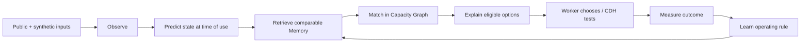

# Technical architecture

## One loop



## Runtime components

### Capacity Graph

Represents the relationships between:

```text
Demand → requires → Functional Requirement
Capacity Unit → belongs to → Place / Asset
Capacity Unit → governed by → Access Rule / Owner
Prediction → estimates → Capacity Unit state at time of use
Outcome → resulted from → Decision / Intervention
Operating Rule → applies within → Context + Deployment Boundary
Operating Rule → contains → Exception + Confidence
```

The hackathon graph is represented as typed in-memory objects. The entity boundaries map directly to a future Neo4j model.

### Constraint engine

Hard constraints establish the eligible set:

- access authorisation and opening hours;
- safe and remaining capacity;
- step-free access and required facilities;
- arrival window and maximum distance;
- environmental thresholds;
- applicable Memory exceptions.

The engine is deterministic and tested. A language model is not part of eligibility.

### Prediction layer

The MVP combines a controlled scenario with live temperature when available. It calculates:

- expected demand and remaining capacity;
- route travel time;
- relative direct UV exposure;
- crowding at the expected time of use.

The same scenario seed is used in the first-pass and Memory-aware comparison.

### Operational Memory

Each record contains:

```ts
Context
+ Capacity / Intervention
+ Outcome
+ Functional Need
+ Exception
+ Deployment Boundary
+ Evidence Type
+ Confidence
```

The browser-local adapter makes the write/retrieve loop visible and persistent during the prototype. The deployed decision endpoint exposes the same domain engine. In a pilot, the adapter can be replaced with Neo4j/Aura without changing the decision contract.

## API

### `GET /api/decision`

Parameters:

- `need`: `standard`, `low-uv` or `step-free`
- `memory`: `1` to retrieve the prototype local rule
- `uv`, `temperature`, `crowding`, `workers`, `departure`
- `seed`: deterministic experiment seed

Returns:

- scenario and functional need;
- controlled experiment output for the requested worker count and seed;
- recommended route;
- eligible state for every route;
- score, predicted exposure and remaining capacity;
- human-readable reasons;
- retrieved Memory rule identifier.

### `GET /api/health`

Returns the deployed engine and evidence mode.

## Deployment

The Vite client and edge decision endpoints deploy together on Vercel. A single deployment keeps the demo fast and avoids cross-service cold starts. No external secrets are required for the core proof.

## Privacy

- Functional constraints are stored instead of diagnoses.
- Capacity metadata is exchanged instead of employee calendars.
- Precinct Memory contains aggregate outcomes rather than named journeys.
