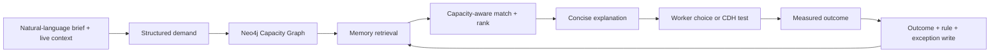
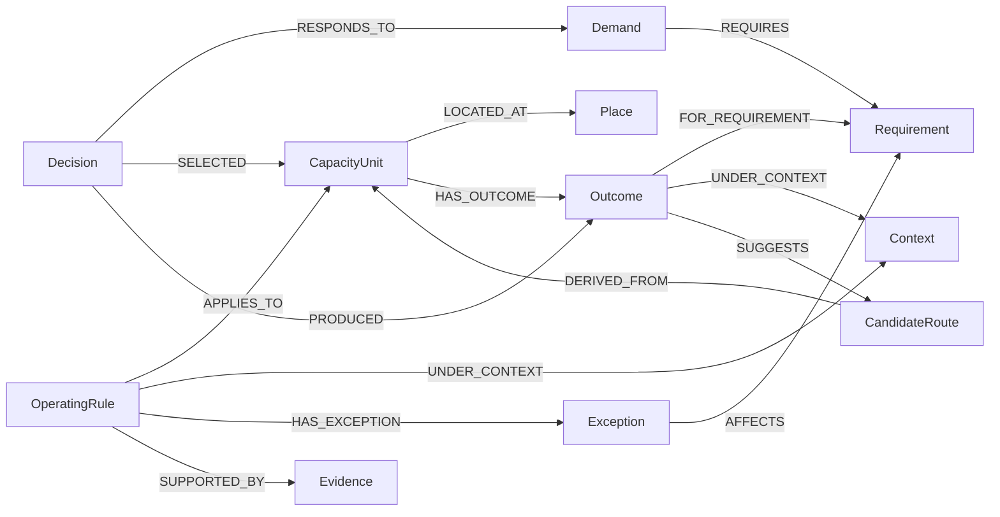

# Technical architecture

## One product loop

The three app views use this same loop:

- **Live Proof** compresses it into a 30-second judge journey.
- **Worker App** runs natural-language route and room requests.
- **CDH Lab** runs controlled comparisons and publishes validated boundaries.

## Runtime

- React + TypeScript + Vite client
- Node.js Vercel Function at `POST /api/decision`
- OpenAI-compatible Structured Outputs for intent and constraint extraction
- Neo4j JavaScript Driver 6 for capacity, outcome and Memory persistence
- graph traversal and structured context/requirement similarity for GraphRAG retrieval
- deterministic constraint, capacity and ranking calculations
- LLM explanation grounded only in the parsed demand, current context and retrieved graph evidence

If external credentials are absent, the same API contract uses a seeded in-memory graph and fallback parser. This keeps tests and offline review available without changing the product flow.

## Neo4j schema

`CapacityUnit` represents both movement and workspace capacity. A route or room enters the worker’s eligible set only after time, access, facilities, functional requirements and remaining capacity are satisfied.

`CandidateRoute` stores an opt-in walked geometry that differs from the known network and received `Better` feedback. It is created with `status: candidate`, remains outside recommendation queries, and can be validated later by CDH.

## Decision actions

### `POST /api/decision` — `action: recommend`

1. Parse the brief into `StructuredDemand`.
2. Resolve the destination against graph places and aliases; ambiguous text returns a clarification instead of silently guessing.
3. Query matching Capacity Units.
4. Retrieve operating rules and outcomes matching the current context and functional requirements.
5. Calculate eligibility, predicted demand, remaining capacity and rank.
6. Generate a short graph-grounded explanation.

### `POST /api/decision` — `action: experiment`

Runs the same demand, UV, horizon and seed against baseline and tested allocation policies. Returns route utilisation, aggregate outcomes, represented cohort outcomes and a candidate operating rule.

### `POST /api/decision` — `action: outcome`

Writes the decision, context, selected capacity, metrics and feedback. It can also publish a CDH operating rule or create an opt-in `CandidateRoute` from a better walked trace.

### `GET /api/health`

Reports whether the running deployment is using Neo4j or the in-memory graph and LLM parsing or the fallback parser.

## Privacy and control

- Store functional needs rather than diagnoses.
- Share capacity metadata rather than calendars or meeting details.
- Request precise location only after the worker starts live guidance.
- Share a newly walked path only after a separate opt-in action.
- Keep one worker’s outcome in Personal Memory; create precinct operating rules through CDH’s controlled comparison.
